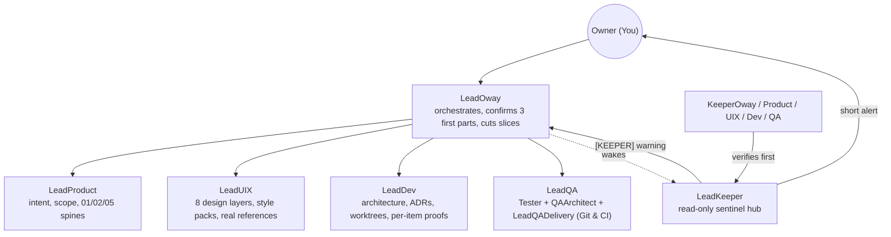

# Oway
Created: unknown · Last edited: 2026-11-19T15:00:00Z

[](CHANGELOG.md)
[](engine/)
[](plugin.json)
[](engine/oway/)

**Team-Based Method & Deterministic Proof Loop for AI-Built Software.**

When AI coding agents work without structure, projects drift: agents invent scope, fake screenshots, lose decisions between sessions, or loop endlessly on side work. **Oway** fixes this by organizing work across clear teams, read-only watchers, an 8-layer real-reference design workflow, and a deterministic proof loop that scripts enforce on disk and in CI.

1. **You hold goals, taste, and gates:** You talk in plain language to `LeadOway` or the team lead (`LeadProduct`, `LeadUIX`, `LeadDev`, `LeadQA`). You never memorize method plumbing.
2. **Named teams carry the method:** [49 role cards and 5 `TEAM.md` contracts](agents/README.md) split orchestration, scope, design, building, independent verification, and read-only keeping.
3. **Scripts enforce the rules:** The `engine/oway/` CLI freezes proof matrices, locks builder write zones, enforces the stop hook, rebuilds `INDEX.md`, and replays keeper proofs without trusting an agent's claims.

> [!IMPORTANT]
> Start with the [Oway Method Entry](docs/oway/README.md), [Teams and Roles (`agents/`)](agents/README.md), [Canonical Glossary](docs/GLOSSARY.md), and [Implementation Status](docs/STATUS.md). For everyday light workflows (`Quick` / `Task` / `Mission`), use [`om/`](om/README.md). Legacy CGSpec v0.3 rules in [`docs/METHOD.md`](docs/METHOD.md) remain only for existing v0.3 consumer projects until migrated via `oway takeover --from cgspec-0.3`.

---

## 1. Organization: Teams, Keepers, and Repository Layout



### Repository Tree (Installed Once in Your Platform, Never Copied Per Project)

| Folder | What Lives Here |
| --- | --- |
| [`agents/`](agents/README.md) | 49 canonical role cards (`oway/`, `keeper/`, `product/`, `uix/`, `dev/`, `qa/`, `shared/`) + 5 `TEAM.md` team contracts |
| [`skills/`](skills/) | 36 shared skills: 10 `oway-*` workflow skills, [`free-ui-ux-scout`](skills/free-ui-ux-scout/SKILL.md), and 25 MIT-licensed Addy Osmani skills |
| [`docs/oway/`](docs/oway/README.md) | Oway v0.4 method specs, templates (`project`, `milestone`, `slice`, `proof-item`, `adr`, `team`, `role-card`), config schema, takeover guide |
| [`engine/oway/`](engine/oway/) | Pure-stdlib Oway CLI (`sync`, `setup`, `doctor`, `index`, `freeze`, `submit`, `check`, `review`, `guard`, `stop-hook`, `keeper`, `style`) |
| [`om/`](om/README.md) | Everyday medium workflow (`om-plan`, `om-assist`, `om-caps`, `om-review`) synced alongside Oway across all 5 harnesses |
| [`docs/METHOD.md`](docs/METHOD.md) | Legacy CGSpec v0.3 enforcement spec kept intact for `oway takeover --from cgspec-0.3` and v0.3 consumer tests |

### Consumer Project Tree (`my-project/`)

Initialized with `oway setup` (no copied engine or skills inside the project):

```text
my-project/
  AGENTS.md                  # rules loaded first
  CONSTRAINTS.md             # deterministic code rules & checkers (owned by QA)
  _oway/
    INDEX.md                 # auto-generated index rebuilt by `oway index` (LeadQADelivery owns script, KeeperQA verifies)
    config.json              # Oway version, language, teams, picked Dev builders, path classes
    capabilities.json        # external tools, channels, browsers declared once
    LEDGER.md / INBOX.md     # append-only decision ledger & scrubbed owner inbox
    project.md               # Goal -> What you get -> The proof you will have
    spines/                  # 01-intent, 02-objects, 03-experience, 04-architecture, 05-delivery
    design/                  # UIX references/, brand/, versions/vN/ (prototype.html, screenshots/, note.md)
    agents/                  # README.md + project-only <team>/TEAM.md & overrides (base cards stay in Oway tool)
    milestones/ & slices/    # bounded deliverables (`*.matrix.md`, `*.walkthrough.md`)
    decisions/ & boards/     # ADRs and multi-model board round logs
    keeper/                  # read-only KeeperX notes & LeadKeeper reports
    state/ & evidence/       # checkpoint.json, frozen criteria, visual-baselines/, hash-chained logs
```

---

## 2. How Work Flows & The Proof Loop

1. **Step 0 (`OwayHelpers`)**: Checks `~/.oway/profile.md` (interviews once if absent), writes `_oway/config.json`, picks active Dev builders, initializes `_oway/agents/README.md`, and verifies with `oway doctor`.
2. **Three First Parts**: Every project, milestone, and slice opens in fixed order: **The goal** -> **What you get** -> **The proof you will have**.
3. **Change Tiers (`T0`–`T3`) & 8 Stages**: Every edit is sized before coding (`T0 Tweak` <= 3 files/40 lines, `T1 Bounded` <= 400 lines, `T2 Feature`, `T3 Structural`), gated across Brainstorming, Design, Architecture, Milestones, Coding, Testing, CI/CD, and Follow-up.
4. **The Proof Loop**:
   - `proof-matrix-author` drafts checks and failing-first verifiers; owner approves; `oway freeze` hashes criteria and locks write zones.
   - Dev builders implement inside exclusive worktree files, calling `oway submit` per proof item while `oway stop-hook` blocks stopping on `OPEN`, `FAIL`, `INSUFFICIENT`, or `NEEDS_REVIEW` (capped at 3 rounds, pivoting after 2 identical failures).
   - `LeadQATester` / `QATester` independently re-run proofs without reading builder claims; `LeadQADelivery` manages Git, waits on CI with non-polling `gh pr checks <pr> --watch`, and escalates `main` merges through `LeadQADelivery -> LeadQA -> Owner`.

---

## 3. TeamUIX: 8 Design Layers & Real References

For UI work, [`LeadUIX`](agents/uix/leaduix.md) and [`agents/uix/TEAM.md`](agents/uix/TEAM.md) follow [`skills/oway-uix`](skills/oway-uix/SKILL.md) and [`skills/free-ui-ux-scout`](skills/free-ui-ux-scout/SKILL.md):

1. Read `spines/01-intent.md` first (never redo Product scope).
2. **Layer 0 & 5a**: Scout up to 6 contrasting real browser references (`oway scout` on Godly/Land-book, Chrome DevTools MCP on Mobbin/Refero/live sites), present a visual carousel + screenshot sketch invite (`Name what you feel`), and pick from the 117 MIT style packs & 50 color themes (`oway style`).
3. **Layers 1–4**: Task map -> Screen map + flows -> Grey wireframe (`Not yet`: no colors/fonts/icons) -> Clickable grey behavior prototype with Playwright journeys & test IDs in `_oway/design/versions/vN/`.
4. **Layers 5b–7 & Lock**: DTCG `tokens.dtcg.json` (plus `getdesign` / permissive design systems) -> real frontend screens with mocked data preserving Layer 4 journeys -> motion tokens -> 65 anti-slop browser checks -> independent `QATester` rubric lock (`min >= 3`, `mean >= 3.5`) into `_oway/evidence/visual-baselines/`.

---

## 4. Shared Skill Stack (`skills/`)

| Group | Skills | Purpose |
| --- | --- | --- |
| **Oway Workflows (10)** | `oway-init`, `oway-adopt`, `oway-forge`, `oway-uix`, `oway-council`, `oway-slice`, `oway-migrate`, `oway-operate`, `oway-team-review`, `oway-pivot` | Stage gates, UIX layers, slices, council boards, migrations, ops, and reviews |
| **UIX Reference Scout (1)** | `free-ui-ux-scout` | Free Godly, Land-book, Mobbin, Refero live scouting + visual carousel blueprints |
| **Addy Osmani Core (25, MIT)** | `interview-me`, `idea-refine`, `spec-driven-development`, `constraint-driven-development`, `frontend-ui-engineering`, `api-and-interface-design`, `planning-and-task-breakdown`, `incremental-implementation`, `test-driven-development`, `browser-testing-with-devtools`, `code-review-and-quality`, `security-and-hardening`, `performance-optimization`, `debugging-and-error-recovery`, `ci-cd-and-automation`, `git-workflow-and-versioning`, `shipping-and-launch`, `documentation-and-adrs`, `context-engineering`, `source-driven-development`, `doubt-driven-development`, `code-simplification`, `deprecation-and-migration`, `observability-and-instrumentation`, `using-agent-skills` | Loaded explicitly per role card across Product, UIX, Dev, and QA (MIT license in [LICENSE-agent-skills-MIT.txt](docs/oway/LICENSE-agent-skills-MIT.txt)) |
| **Oway Medium (`om/`, 2)** | `om-plan`, `om-assist` | Light `Quick` / `Task` / `Mission` daily driver synced via `oway sync` |

---

## 5. Quickstart & Multi-Harness Installation

### Sync One Checkout Into All 5 Local AI Harnesses

```bash
python3 engine/oway sync --tools pi,opencode,claude,codex,antigravity,oway --oway-skills --oway-agents
python3 engine/oway sync --tools pi,opencode,claude,codex,antigravity,oway --oway-skills --oway-agents --check
```

### Initialize a Platform & Consumer Project

```bash
oway platform init
oway setup --language en --builder DevBackend --builder DevFrontend
oway doctor
```

### Legacy v0.3 Plugin / Sandbox Commands

For existing CGSpec v0.3 consumer sandboxes or plugin upgrades:

```bash
mkdir -p /tmp/oway-example
python3 engine/install.py install --root /tmp/oway-example --profile web-workspace --topology single --tools git
python3 engine/doctor.py --root /tmp/oway-example
python3 engine/install.py verify --root /tmp/oway-example
```

- **Claude Code:** `claude plugin update oway@<marketplace>`
- **Antigravity:** `agy plugin install <plugin-directory>`
- **Codex:** `codex plugin marketplace add <plugin-directory>` and install `oway@oway-local`

### Validate This Repository

```bash
python3 -m unittest discover -s tests -t .
python3 .githooks/source_precommit.py
```

---

## Navigation Map

| If you want to... | Read |
| --- | --- |
| Learn Oway v0.4 (teams, proof loop, 8 design layers, rules) | [Oway Method Entry](docs/oway/README.md) |
| Browse all 49 role cards & 5 `TEAM.md` team contracts | [Agent Roles (`agents/`)](agents/README.md) |
| Look up canonical Oway & `om` terminology | [Canonical Glossary](docs/GLOSSARY.md) |
| Check implementation status & honest remaining limits | [Implementation Status](docs/STATUS.md) |
| Inspect engine CLI commands & formats | [Engine Formats](engine/FORMATS.md) · [Short Contract](engine/CONTRACT.md) |
| Use everyday Oway Medium (`Quick` / `Task` / `Mission`) | [om Overview](om/README.md) |
| Read legacy v0.3 enforcement specification | [Legacy v0.3 Method Specification](docs/METHOD.md) |
| Contribute to this repository | [Contributor Entry](AGENTS.md) |
