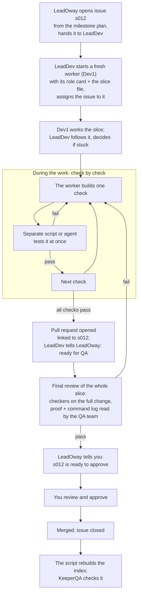

# Example setup
Created: 2026-11-15T12:30:00Z · Last edited: 2026-11-15T14:20:00Z

What you would actually see, once Oway is set up on one project.

## Two places, one rule

- **The repo holds the content**: documents as markdown files, reviewed through pull requests.
- **GitHub holds the live work**: milestones, issues, pull requests, your reviews.
- **The index joins both**, rebuilt by a script.

## 1. In the repo

```
my-project/
  AGENTS.md              # rules file: every agent loads it first
  CONSTRAINTS.md         # your code rules and the checkers (the QA team owns it)
  _oway/                 # only THIS project's files; no copy of the Oway tool or skills
    INDEX.md             # built by a script: every file, its state, approval, last update
    config.json          # Oway version, language of the project, path rules (was _cgspec/project.json)
    capabilities.json    # what agents may use beyond the repo, declared once
    LEDGER.md            # append-only log of decisions and events, written by a script (CGSpec _memlog)
    INBOX.md             # every message you send, secrets removed (CGSpec 00-INBOX); created on first message
    project.md           # short: goal, what you get, the proof; links to the spines
    spines/              # one file per part, never merged; owned by the Product team
      01-intent.md       # why, for whom, success, anti-goals, business model, V1 boundary, parked list
      02-objects.md      # objects, states, rules, permissions, task-to-object check (was OOUX);
                         #   field lists move to the schema + tests once Dev starts
      03-experience.md   # style register, screens, flows; links to design/versions
      04-architecture.md # short context only; every choice is an ADR in decisions/
      05-delivery.md     # order of milestones, risks, KPIs; the phases ARE the milestone files
    research/            # visible, not inside the tool folder (CGSpec RES-NNN)
      RES-001-local-housing-market.md
    design/              # owned by the UIX team (was prototypes/_vision)
      README.md          # which version is current, and one line per version
      references/        # yours and competitors in one place, named by source
        you-airbnb-split-map.jpg
        competitor-studapart.png
      brand/             # logos
      versions/
        v1/              # everything about one version together
          prototype.html
          screenshots/
          note.md        # what was tried, what you said, what was kept
        v5/
    agents/              # role cards of THIS project (from the Oway role cards)
      oway/
        leadoway.md
        owayhelper.md      # setup only
        leadowayboard.md
        leadowayscout.md
      keeper/            # all the watchers, under LeadKeeper, not under the team leads
        leadkeeper.md
        keeperoway.md      # watches LeadOway itself
        keeperproduct.md
        keeperuix.md
        keeperdev.md
        keeperqa.md
      product/
        TEAM.md          # the team: its lead, members, how they split the work, who talks to whom
        leadproduct.md
        leadproductboard.md
        leadproductscout.md
        scoutproduct.md
      uix/
        TEAM.md
        leaduix.md
        leaduixboard.md
        leaduixscout.md
        scoutuix.md
        uix.md           # UIX1, UIX2... all run from this one card
      dev/
        TEAM.md
        leaddev.md
        leaddevboard.md
        leaddevscout.md
        scoutdev.md
        devops.md        # always there
        devbackend.md    # builders picked at setup, for example
        devdata.md
      qa/
        TEAM.md
        leadqa.md
        leadqaboard.md
        leadqascout.md
        leadqatester.md
        leadqadelivery.md
        leadqaarchitect.md
        scoutqa.md
    keeper/              # the keepers' working files; only keepers write here
      INDEX.md           # one line per finding: id, type, team, state, since; read before sending
      notes/             # one file per finding: fact, proof, since, who was told, resolved line
        F-20261115-a3k9.md
      reports/           # LeadKeeper's full report, at the interval set in Step 0
        2026-11-15T14.md
    milestones/
      m2-supplier-data.md   # the truth; GitHub gets a copy pushed by a script
    slices/
      s012-load-suppliers.md
    decisions/           # ADRs, one per choice, with its why
    boards/              # board rounds and summaries (from CGSpec councils)
    state/
      checkpoint.json    # goal, next action, what is waiting for you
                         # tier, frozen criteria, quota, legacy list: created only when used
    evidence/            # test pairs and check results, each with its revision and verdict
      visual-baselines/  # frozen screens QA compares against (was _snapshots)
  src/ ...               # the code
```

The Oway tool (scripts, hooks, the doctor), the templates and the shared skills (Oway's own, agent-skills, Matt Pocock's skills) are installed once in your Platform, never copied into a project: a copy drifts (CampusNest carries 1.5 MB of copied engine and skills). A folder appears only when it gets its first file. Every link is relative, so it works on GitHub. Tools like Claude Code want a flat list of agents, so the setup script generates names like leadqa from this tree. Milestones and slices have one source of truth: the file holds the content and a script pushes a copy to GitHub; GitHub holds only the state (open, closed, approved), which the index reads back.

## 2. On GitHub

| You see | What it is |
| --- | --- |
| Milestone "m2-supplier-data" | One Oway milestone, with a progress bar |
| Issue "s012 Load supplier data" | One slice; its checks are checkboxes; assigned to whoever claimed it |
| Pull request linked to the issue | The work; the checkers run on it automatically |
| Your review "Approve" | The gate. Only your account can do it; agents use a bot account |
| `main` branch | Protected: nobody pushes to it directly |

## 3. One slice, from start to end



## 4. What LeadOway actually does

LeadOway does little work with its own hands, on purpose, but it is the one that keeps the project moving:

| When | LeadOway |
| --- | --- |
| After the scope and the architecture | Turns them into milestones and slices: writes the plan, opens the issues |
| Every time a slice closes | Picks the next slices that are not blocked, and hands them to the Dev team |
| When a team is stuck or two teams disagree | Decides, or asks a lead to start a board, or asks you |
| When LeadKeeper warns | Decides what to do about it |
| At each gate | Tells you, in one short message, what is ready for your approval and where the proof is |

Without LeadOway, you would do all of this yourself, which is what agent-skills assumes. On a small project you can be LeadOway; on a big one it saves you that work.

## 5. Big and foggy projects: LeadOway plans with a map

When a project is too big to see the route, LeadOway first uses Matt Pocock's **wayfinder** skill: one GitHub issue is the map (destination, decisions so far, what is still unclear), and each child issue is one question to decide. Only when nothing is left to decide does LeadOway turn the map into milestones and slices. Same idea as our index: the map lists things and links to them; the detail lives in one place only.

## 6. What the Platform contains

Oway is meant for anyone. It ships a Platform **template** (folder layout + setup script); setup asks a new user for their accounts, machines and channels and creates their own Platform. The last column shows one real Platform, called `_CG-Gov`, as an example.

| Piece | What every Platform has | Example: your setup today |
| --- | --- | --- |
| Your profile | How you code, your rules, tools and accounts, written once by the OwayHelpers; every new project reads it instead of asking again | `_CG-Gov/oway/profile.md` |
| Method files | The Oway rules and skills every agent loads | `_CG-Gov/cgm/` |
| Model policy | Which AI model does which job (to decide later, per agent) | `model-policy.md` |
| AI accounts | The user's accounts, quotas and token tracking | infra lead + `scripts/` |
| Safety guards | Hooks, time and CPU limits, proofs that can't be edited | `_CG-Gov/guards/` |
| Machines | Where agents run, backups, monitoring, alerts | VPS, `hosts/`, WhatsApp, e-mail |
| Secrets map | Which agent may use which secret (names only) | `_CG-Gov/maps/` |
| Capabilities | What each lead is allowed to do | WhatsApp for the infra lead and the data project lead |
