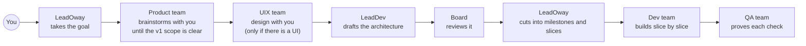
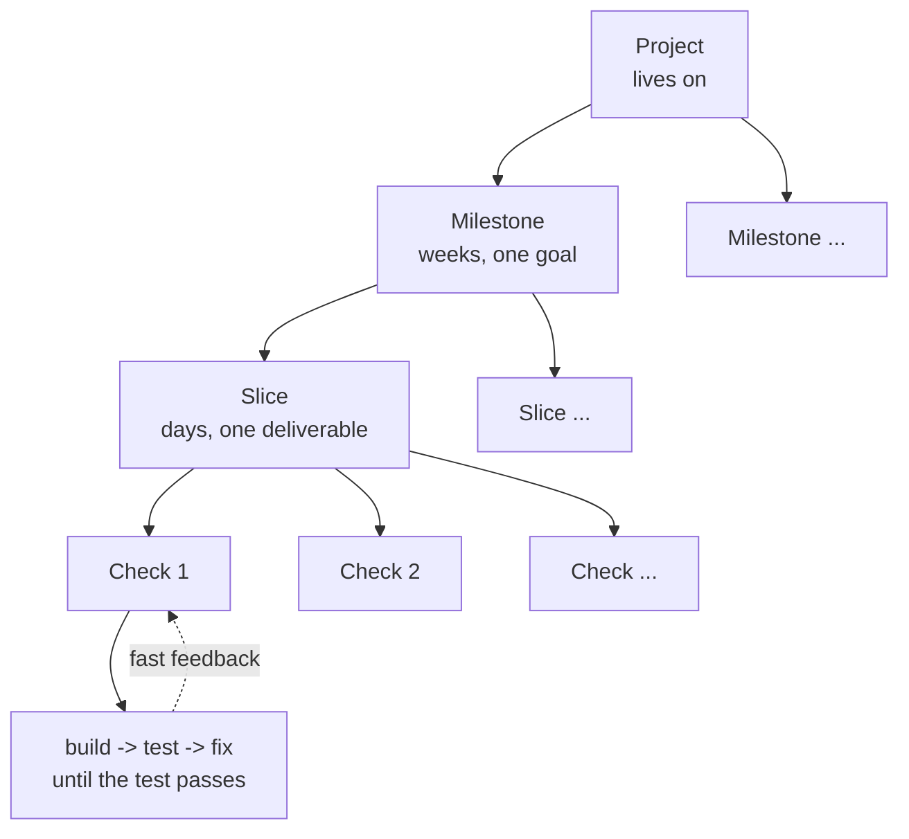
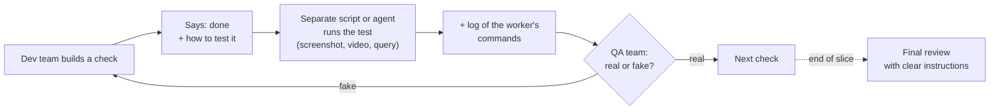

# How work flows
Created: 2026-11-15T12:30:00Z · Last edited: 2026-11-15T15:00:00Z

How work is cut (Project > Milestone > Slice > Check), sized, started, tested and planned. Names as in Teams and roles.

## Step 0: setup

Run once by LeadOway when a project starts, before any work. Scripts do most of it.

1. Check the Oway tool is installed and write `_oway/config.json` (Oway version, language of the project).
2. Declare capabilities: what agents may use beyond the repo.
3. Start quota tracking for each AI account, with CGSpec's levels (25/15/5%) and a checkpoint before a limit is hit.
4. Install the keeper watcher: it wakes a KeeperX when its team starts working, and puts it to sleep when the team stops.
5. Connect GitHub: the bot app, protected `main`, the sync Action.
6. Set the keeper report interval with you.
7. Run the doctor once. Work starts only when it passes.

**Before step 1: the OwayHelpers.** OwayHelpers are short-lived helpers under LeadOway that work only during setup, then stop. They first look on your machine for your Oway profile (`<your Platform>/oway/profile.md`).

- **No profile yet (the very first time):** they introduce Oway to you, interview you (how you code, your rules, your tools and accounts), look at your space, discuss what they found with you, and write your profile. This happens once, not on every project.
- **Profile found:** no interview. They show you a short summary of it, and you can change it (re-running only that part).
- **Each project:** a short interview about this project only (goal, language, report interval), then steps 1 to 7.
- **An old project:** the same, plus they first analyse the existing code and docs (see "Joining a project that already started").

## Every piece of work starts with three parts

Whatever the size, work starts with the same three parts, written by you with one agent:

1. **The goal**, clear.
2. **What you get**, concretely.
3. **The full proof matrix**: every check that will prove it is done (see [The proof loop](proof-loop.md)).

Then LeadOway cuts it into milestones and slices and hands over to the teams.

Who writes the three parts with you depends on the work:

| Situation | Who you talk to | LeadOway's job |
| --- | --- | --- |
| Small or mid-project, no UI, you know what you want | LeadOway directly | Checks the three parts are complete and clear; no brainstorming |
| New or fuzzy idea | LeadProduct (the deep talk, "grill me") | Sends you there, then confirms what comes back |
| UI involved | LeadProduct, plus LeadUIX for the design | Same |

LeadOway is the one door: it decides who you talk to (itself, Product, UIX), it never writes the three parts alone, and it always confirms them before cutting the work.

## From your goal to the first slice

1. You give the goal to **LeadOway**.
2. LeadOway hands the idea phase to the **Product team**; you brainstorm with LeadProduct until the v1 scope is clear. The **UIX team** works with you directly on the design and user experience, using the UI style packs.
3. **LeadDev drafts the technical architecture**, because its team builds it. You discuss with it directly if you want. If you don't, LeadOway lets it go ahead, or asks you at the right moment. A board (run by LeadDevBoard) reviews the draft.
4. **LeadOway does the planning**: it turns the scope and the architecture into milestones and slices, and hands them to the Dev team. The Dev team does not plan the project; it plans how to build each slice.
5. **The QA team** proves each check and tells LeadOway, or you, when something is wrong. The keepers watch all of this (see [Teams and roles](teams-and-roles.md)).

**Milestone or just a slice? (draft, waiting for the owner's OK)** One deliverable, done in a few days: one slice. Several deliverables toward one goal, or more than about a week of work: a milestone with its slices. LeadDev checks that the cut can be built, then you approve the plan.

**Two kinds of milestone.** A **build** milestone holds slices with checks. A **business** milestone holds work that is not code (interviews, seeding listings, measuring KPIs): its file lists tasks, each with an owner and a result you can see (a count, a document, a decision), and no proof matrix. The delivery spine lists all milestones in order and shows the current one; that milestone's own header says `current: true`, and only one may. Work already done before Oway (for example design versions v1 to v5) is not turned into slices: one ledger line records it as done, with a link.

## Change tiers

Before any edit, LeadOway sizes the change into a tier and writes it to a file. Hooks enforce the tier, so no change can skip a gate by calling itself small. Going over a limit moves the change up a tier automatically.

| Tier | Limits (all must hold) | What is written | Review |
| --- | --- | --- | --- |
| T0 Tweak | 3 files or fewer, 40 changed lines or fewer, no new file, no change to schema, API, auth, dependencies or a locked design | One line in the tier file listing the files, one ledger line | Checker scripts only |
| T1 Bounded | Inside one approved slice's files; 400 changed lines or fewer | Short slice + start agreement + ledger | Scripts + 1 reviewer from the QA team |
| T2 Feature | New screen, flow, service or data model piece | Project sections + full slice + ADR if there is a real choice | Scripts + 1 QA reviewer; up to 3 helper agents at once |
| T3 Structural | New product, architecture change, migration, auth or data change, anything irreversible | Full flow + migration and recovery plan | Scripts + QA team + a board; up to 6 helper agents at once |

The sizing table further down says which teams are switched on; the tier says which rules apply.

## The 8 stages and their gates (from CGSpec)

A map with loops, not a corridor: different parts of the product can be at different stages. Each stage ends with a gate: a checklist that must be complete and approved by you.

| Stage | Gate: what must exist | Team |
| --- | --- | --- |
| 1 Brainstorming | Goal type; for a money goal, a research record (competitors, who pays, price, demand, risks); intent, users, anti-goals; the main things and their links; permissions; v0.1 scope, later ideas parked | Product |
| 2 Design | Design layers locked for the screens in scope; no UI: API draft, examples, error model | UIX |
| 3 Architecture | An ADR for every choice with consequences; data model; contracts; spikes done | Dev, with a board |
| 4 Milestones | Ordered slices, each with its files, interfaces and checks | LeadOway |
| 5 Coding | Code inside the slice's files; a failing test recorded before each change; unit tests pass | Dev |
| 6 Testing | All tests the product type requires pass at a named revision | QA |
| 7 CI/CD | The same tests run on every push; release and rollback plan | QA delivery |
| 8 Follow-up | Watch period, incidents sorted, lessons in the ledger | QA delivery, LeadKeeper |

Before a gate closes, the team checks nothing is missing (every thing has a place, every screen traces to a task) and asks you: "Here is what might still be missing. Anything else before I lock?"

## The start agreement (from CGSpec)

This is your "three first parts" made strict. Before coding a T1 slice or bigger, the team writes a start file: the outcomes you will see, examples of what is accepted and what is rejected, what is out of scope, how each outcome is evaluated, and when you will be asked to check. You approve the definition and the evaluation together. No agent approves its own start agreement.

## How the work is organised

Four levels: a project has milestones, a milestone has slices, a slice has checks.

- A **milestone** is an index of slices toward one goal. It ends; the project keeps going. Every milestone names its main goal in one sentence (the keepers read it first).
- A **slice** is one deliverable. Its checks are the steps.
- Each **check** is tested as soon as it is built, so the agent gets feedback in minutes. At the end of the slice, one final review looks at the whole.

Sizing rules:

- A check is one thing that must be true, not one piece of code. One build can satisfy several checks; each is still tested on its own.
- A check can need several tests (normal case, error case, edge case). Example: "upload rejects files over 10 MB" = 1 check, tested with a 9 MB and an 11 MB file.
- If something needs its own full matrix (a stress test with many scenarios), it is its own slice.

**Data engineering fits the same way.** Slice: "load supplier data into the warehouse". Checks: the table has the right columns; row count matches the source; no duplicate IDs; totals match a reference. The test is a query run by a separate script, which makes data work easier to check reliably than screens.

## Same process for every size

One process and the same names for every project. Size only changes how many milestones and slices there are, and which roles are switched on. A small request is not a different kind of thing: it is a slice. A request in your app becomes a new slice in that app's project. Installing an app is a slice in the Platform's own project, led by the infra lead.

| Size | Example | Shape of the work | Roles switched on |
| --- | --- | --- | --- |
| Small | Install an app; a small change request in my app | 1 slice, no milestone | LeadOway (very light), Dev team (1 agent), QA team, keepers. No Product team: your request is the scope. UIX team only if a screen changes |
| Normal | A new feature | 1 milestone, a few slices | Add the Product team, and the UIX team if there is a UI |
| Big | A data platform | Many milestones | All roles. A team can be one agent on small projects and several on big ones; the name stays the same |

Two rules stay the same at every size: the builder never checks its own work, and the keepers are always there.

## Testing during the work

Test each check during the work, not only at the end. The Dev team never makes its own proof.

Extra idea: ask for a random word in the proof (for example BANANA-992), so a fake is harder to make. Rule-based tests run as a command line tool.

More rules for proofs:

- **Who writes the matrix:** once the goal is clear, a strong model (or another agent) drafts the full list of checks, not the worker. Bigger work may need levels of detail.
- **Final review:** give the final reviewer precise, rule-based instructions so it does not simply agree with the worker.
- **Proving the agent really used the tool:** attach the log of the exact commands the agent ran (for example the last 2 minutes) to every proof. For browser work, add a Playwright trace (heal-playwright-tracer). The judge model reads both.

Open-source tools to try:

| Tool | What it does for us |
| --- | --- |
| **deepeval** (confident-ai) | Test framework for AI output, used like pytest and run from the command line. Its metrics (task completion, hallucination, custom criteria) can turn a check into a scored test. Good fit for the QA team |
| browser-use | Drives a real browser from a plain-language check and records what happens, so the worker cannot fake screenshots |
| Midscene.js | Visual UI testing with replay reports (video, screenshots, step logs) |
| Inspect AI (UK AISI) | Reads an agent's full command history to spot cheating |
| playwright-mcp | Proof only through a real browser tool; the agent cannot upload its own image |

## The board in planning

A board (see [Teams and roles](teams-and-roles.md)) is used mostly during planning: scope, technical architecture, the matrix of checks. Each member gives an opinion on its own model; the board lead (LeadDevBoard...) supervises, summarises and gives the summary to its team lead, who decides.

## Joining a project that already started

The step-by-step recipe, with the CGSpec-to-Oway path table and the rollback, is in [Taking over a project](takeover.md).

When code or docs already exist, Oway does a takeover first: scouts map what exists (code, docs, Git history, state) into the Oway files and the index; LeadQAArchitect runs the checkers and lists where the rules are broken; files that break the rules today go in a legacy list, exempt with your approval. New code follows the rules at once; old code is fixed slice by slice. When Oway itself gets a new version, the same flow runs in upgrade mode.

## After shipping (from CGSpec)

LeadQADelivery runs the follow-up: release (pipeline, notes, rollback or forward fix), a watch period, incidents (sorted first, then written in the ledger, where each one becomes a new rule or check), drift (code, docs and what is deployed disagree: shown to you, never fixed silently), and retiring a feature. Access to the infrastructure never means permission to change it.
