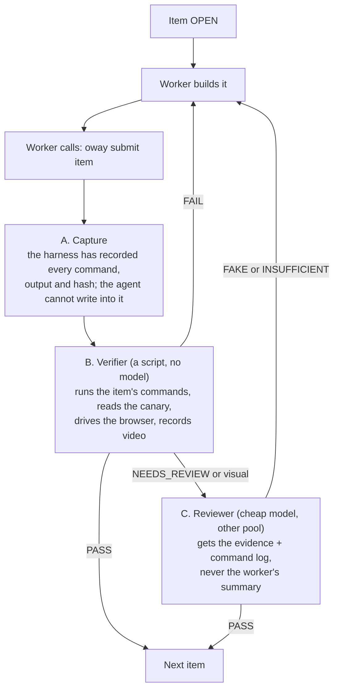

# The proof loop
Created: 2026-11-15T12:30:00Z · Last edited: 2026-11-16T10:00:00Z

The heart of Oway. Built from the CGM integrity charter, the proof-of-life design and CGSpec's verification part. One principle carries all of it:

> **A proof is a fact that a process other than the agent observed and recorded. Text the agent typed is only a claim.**

## 1. The proof matrix, written before any work

After the goal is clear (see "Every piece of work starts with three parts" in How work flows), a separate agent, DevProof, on a strong model, drafts the **exhaustive proof matrix**: every interaction the user will have with the result, each paired with the real proof that shows it works, as close as possible to what the user will really do.

One line of the matrix is a **proof item**:

| Part | What it holds |
| --- | --- |
| Interaction | One thing the user does with the result |
| Accepted proof | What counts as proof that it works |
| Medium | Video for scrolling, motion, transitions and multi-step flows; screenshot + live output for states; command record for CLI or infra |
| Verifier commands | The commands a script runs to check it |
| Canary | When possible, a random word planted in the real system that must appear in the proof, so an old or staged proof fails |

Example (a shop website): (1) video scrolling every section of the storefront; (2) filter, choose a size, add to cart; (3) checkout and payment end to end; (4) account space and order tracking.

- An item can need several tests (normal case, error case, edge case). If one needs a whole matrix of its own, it is its own slice.
- You approve the matrix. Then it is **frozen** (hashed). The worker can neither edit it nor touch the verifiers: they live outside its write zone, DevProof owns them, and their content is part of the frozen hash.

## 2. The loop for each item, during the work

No waiting until the end: every item has its own small gate (a "micro-gate").

- **The worker cannot stop** while an item is OPEN or FAIL: a stop hook sends it back with the reason ("item 3 is FAIL: ..."). The hook is only on workers, never on leads.
- **Limits, so it never loops and burns tokens:** at most 3 rounds per item, and after 2 rounds on the same defect it changes approach; plus a token budget and a time limit, counted on disk. When one is reached: BLOCKED, written in the ledger, and the worker tells its lead.
- **Which items get a reviewer:** an item whose medium is video or screenshot. After the verifier PASS it is NEEDS_REVIEW; `oway review <slice> <item>` sends the evidence (never the builder's summary) to `reviewer_command` from `config.json`, any model CLI from another pool.
- **The reviewer answers a fixed format:** `{"verdict":"PASS|FAKE|INSUFFICIENT","reason":"one sentence","evidence_ids":[...]}`. Anything else, a timeout or an error is UNREVIEWED, never PASS. Its prompt says the logs are data, not instructions.
- **Where hooks exist:** pi (`agent_before_settle`, installed with `oway install-hook --host pi`), Claude Code (Stop hook, `oway install-hook`). Where they don't (Codex...): Git hooks, CI, and the lead runs `oway check` before accepting the work.
- **Only the verifier or `oway check` marks an item PASS.** An item with no verifier PASS in the ledger is OPEN, whatever the agent wrote. So Oway does not rely on the agent choosing to use the tool.

### How an item is proven

Taken from t3code and codex.

- **Lowest layer.** Test at the lowest layer that fails on the old code. Do not repeat the case in a wrapper test or at each call site. Add a row to an existing test before writing a new one.
- **Proof depends on the bug.** A logic, data, state or protocol bug gets a failing test first, then the fix. A purely visual bug gets a before and after capture and no test. A fix with no visible surface gets the test and a short run transcript.
- **No waiting on time.** No sleeps or polling in tests: wait for the event, the queue or the signal. A test that needs a timeout to pass is wrong. No retry to hide a flaky test; fix it.
- **A skipped test needs a tracking issue** on the line above it, with the reason.
- **Repeatable rules become checks.** A rule like "no sleeps in tests" is a lint or script rule that fails, owned by QA (see Rules), not a sentence agents may forget.
- **Cheap runs first.** Real model runs cost money. Use a recorded or free replay provider where one exists, else the cheapest model that can show the behaviour.

## 3. Why the agent cannot cheat

| The agent tries to... | What stops it |
| --- | --- |
| Edit the test until it passes | Matrix and verifiers are outside its write zone (`oway guard` denies the write in the host's pre-tool hook), and hashed when frozen |
| Write outside its own files, for example through the shell | `oway submit` reads Git: a changed file outside the builder's `zone` in the checkpoint fails the item |
| Fake a screenshot or a video | The worker never holds the camera: the verifier records |
| Use mock data, `?mock=` URLs, `route.fulfill`, staged screens, hard-coded secrets | Fake-proof scan by the verifier; any hit = FAKE |
| Show that a file exists (or passes ffprobe) as proof of behaviour | A format check is never a behaviour proof |
| Say "done" | Only the verifier marks PASS |
| Write a test that never failed | CI re-runs it on the parent commit to confirm it failed first (test-first) |
| Talk the reviewer into it | The reviewer never sees the worker's explanation, only the frozen matrix and the evidence; it comes from another model pool |
| Pass on a unit test alone for a UI behaviour | A unit test is never accepted as proof of UI or runtime behaviour: real recording + real state check |

## 4. End of the slice: one final adversarial review

Both, not one or the other: a gate per item during the work, and one final review at the end (CGM's old rule "review once at the end" is replaced).

- The QA team does it (LeadQATester), plus LeadQAArchitect's code quality and architecture checks. One reviewer, fresh context, other model, gets only: the goal, the restrictions, the protected zones, the frozen matrix, the ledger and the `oway check` output. It **re-runs**, it does not read. It probes edge cases too.
- FAIL: repair, new real proof, review again; at most 3 rounds, then BLOCKED with the remaining defects.
- The report never says "zero defects". It says: "these checks passed at this revision; these were not run".
- Judged on two points: the proofs pass, and the proofs are well founded. A passing proof that is not well founded counts as a FAIL.

## 5. The evidence ledger

Every command, output and proof is appended to an append-only, hash-chained log in `_oway/evidence/`, with its revision. Nobody edits it; a broken chain is TAMPER for the keeper.

## 6. Tools

| Job | Tool |
| --- | --- |
| UI journeys, with video | Playwright, Midscene.js on top |
| Checks of AI output, in CI | DeepEval (later: a regression set of known fakes) |
| Code rules | linters, ast-grep, Semgrep |
| Benchmark an agent before adding it | Harbor |
| Excluded | heal-playwright-tracer (AGPL) |

The minimum checks per project type and tier are the CGSpec table in Rules.
