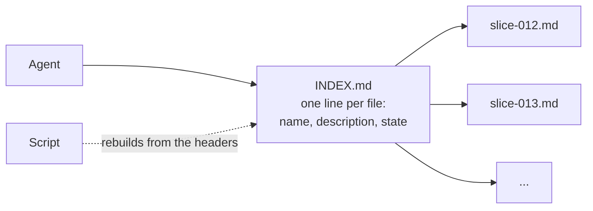

# Rules
Created: 2026-11-15T12:30:00Z · Last edited: 2026-11-15T15:00:00Z

The hard rules every agent follows: code is the truth, the file format, approvals, code rules checked by tools, and the keeper rules. Comment on any line.

## The code is the truth

Docs that only explain *how* the code works drift away from it. Then the agent sees two "truths" and does not know which one to trust. So in Oway:

- **The code and its tests are the source of truth** for how things work.
- **Agents do not write docs that only explain the code.** The code itself must be clear: good names, small files, interfaces kept apart from their implementations.
- **The only docs we keep** say *what* and *why*, which the code cannot say: specs, checks (each proven by a test), decision records (ADRs: why we chose this, what else we considered), the glossary (what our words mean), and a thin map to find your way around. That map is the index, rebuilt by the script from the real files, never written by hand.
- **If a doc and the code disagree, the code wins.** KeeperQA flags the doc so it gets fixed.

This fits Matt Pocock's grill-with-docs skill, which keeps only the glossary and ADRs.

## File format: the rule

Agents never load everything. Each folder has an **index**. An agent reads the index first, then opens only the file it needs. Each file holds one thing (one slice, one role, one rule) and starts with the same **header**, so the index can be built from the headers by a script instead of being written by hand.



## The header (every file)

```
---
name: slice-012-load-suppliers
description: Load supplier data into the warehouse
type: slice            # see the table of types below
parent: M2-supplier-data
state: in-progress     # the states allowed for this type, see below
created: 2026-11-13
approved: 2026-11-14 by @your-github-username   # "no" while not approved
owner: LeadDev
updated: 2026-11-15 by LeadQA   # written by a script, never by hand
---
```

| Field | Meaning | Always there? |
| --- | --- | --- |
| name | Short unique name, also the file name | Yes |
| description | One line: what it is | Yes |
| type | What kind of file | Yes |
| parent | The milestone of a slice, the project of a milestone | When there is one |
| state | Where it is now | Yes |
| created | Date it was created | Yes |
| approved | Date and the Git username of the person who approved it; "no" while not approved | Yes |
| owner | Which role keeps it up to date. Next to it, updated: the date of the last edit and which agent made it (e.g. LeadQA, Dev2) | Yes |

**Types and their states.** One list, checked by `oway doctor`. A type not in this list is refused.

| type | Used for | States |
| --- | --- | --- |
| project | `_oway/project.md` | draft, approved, done |
| milestone | `_oway/milestones/` | draft, approved, in-progress, done |
| slice | `_oway/slices/` | draft, approved, in-progress, in-review, done, blocked |
| matrix | a slice's proof matrix | draft, frozen |
| spine | `_oway/spines/` | draft, approved, superseded |
| research | `_oway/research/` | draft, done |
| design | `_oway/design/` README and version notes | draft, locked, superseded |
| decision | `_oway/decisions/` (ADRs) | proposed, accepted, superseded |
| agent | a role card or a project override | draft, approved |
| team | `_oway/agents/<team>/TEAM.md` | draft, approved |
| rule | `AGENTS.md`, `CONSTRAINTS.md` | draft, approved |
| profile | the owner profile on the Platform | draft, approved |

**Files without a header.** `INDEX.md` files are written by the index script and carry only its generated line. `LEDGER.md` and `INBOX.md` are append-only logs written by their scripts: a title, the date line, then entries. JSON files (`config.json`, `capabilities.json`, `state/*.json`) never get a Markdown header; their schema says what they hold. A spine that an older method marked "Proposed" becomes `state: draft`.

**As automatic as possible.** The header is filled by a script or a hook, not typed by the agent: `created` and `updated` come from Git, `approved` comes from GitHub, and `state` changes only through set steps. An agent cannot write a wrong date or a fake approval in the header.

## The index (one per folder)

| name | description | state | updated |
| --- | --- | --- | --- |
| slice-012-load-suppliers | Load supplier data into the warehouse | in-progress | 2026-11-14 |
| slice-013-check-duplicates | No duplicate supplier IDs | draft | 2026-11-13 |

A script (a small program, no AI) rebuilds every index on each push to GitHub, so an index is never out of date. LeadQADelivery owns the script and makes sure it runs; KeeperQA only checks the indexes are right and warns if not.

**Many small indexes, never one big one**. One index per folder and per team, each listing only a few files. An index is a way to discover: an agent opens only the index of its own zone, and some agents need none at all (a scout gets the exact files of its zone). The top index only lists the folders and teams, one line each.

## Taken from agent-skills

- **Stable ids.** Every milestone and slice gets a short id that never changes (`m2-supplier-data`, `s012-load-suppliers`). The file name, the GitHub issue, the branch and the index all use it.
- **Load in layers.** Each role card says what the agent always loads (its card, the rules file) and what it loads only for the current task (one spec section, the files it changes, the failing line), never the whole project.

## Approvals and Git

The CGSpec keys are dropped. They are hard to use and do not really stop a fake. Instead, Oway lets GitHub do the work, because GitHub already solves it:

- **An approval is a GitHub action from your own account**: a pull request review "Approve", or your comment on the issue. Agents work with a separate account (a bot), so they cannot approve as you. The header field `approved` copies what GitHub shows, and KeeperQA checks that the two match.
- **`main` is protected by default** (also `dev` and `staging` if they exist): no direct push, a pull request is required, your review is required, and the checkers must pass. GitHub blocks a push to main; we do not rely on the agent's good behaviour.
- **KeeperQA watches anyway** and tells you if anyone tried to push to a protected branch.
- **Every pull request is linked to an issue**, so the full history of each piece of work is in GitHub.
- **Approvals made before Oway, or outside GitHub.** When the owner approved something in chat or in an older method, and that approval is recorded (a ledger line, an inbox message, a CGSpec approval), the header says where: `approved: 2026-11-12 by owner (ledger L-20261112-x7q2)`. KeeperQA checks that the record exists. With no record, it stays `approved: no` until the owner approves it again on GitHub.

Oway names map to GitHub:

| Oway | GitHub |
| --- | --- |
| Milestone | Milestone |
| Slice | Issue (and its pull request) |
| Check | A checkbox in the issue, proven by a CI check |
| Approval | Your review "Approve" on the pull request |
| Versions and packages | Releases and Packages |

## Code rules, checked by tools, not by trust

Before any code is written, LeadDev first reads the code rules the OwayHelpers already recorded at setup (your profile, then the project's rules file). It asks you only about what is missing or new for this project, during your technical talk with the Dev team (the same talk as the architecture, see [How work flows](how-work-flows.md)), writes the answers in the project's rules file, and enforces them. Examples of such rules:

- No code file longer than 500 lines.
- No nested return: write an intermediate variable first.

The checks must be deterministic: a tool says yes or no, not an AI opinion. Existing open-source tools do this for many languages at once, so we do not write one checker per language:

- **ast-grep** and **Semgrep**: custom rules on the code structure (good for "no nested return").
- **Linters per language** (ESLint, Ruff...): built-in rules such as max file length.
- **MegaLinter**: runs many linters in one command.

The checkers run inside the QA team's tests and before every commit, so a broken rule blocks the slice.

**If you skip the talk**, the Dev team does not wait: it uses the default good practices from the skills (Addy Osmani's), enforced by the same checkers.

**Who owns what (draft, waiting for the owner's OK):**

|  | Dev team | QA team |
| --- | --- | --- |
| Technical choices (language, framework, architecture) | Decides, with you or a board | Gives no opinion |
| The rules (what must be true) | Asks you, writes them down | Reads them |
| The checkers (tools and their settings that say yes or no) | Can run them for fast feedback, **cannot change them** | Chooses, sets up and keeps them |
| Deciding pass or fail | Never | Yes, from the checker results |

The distinction: the Dev team decides **how to build**; the QA team owns **how we know it is right**. Same reason as "the builder never checks its own work": if the Dev team could edit the checkers, it could make them pass.

## Keeper rules

**A keeper is read-only: it never stops work itself.** A team keeper sees the problem and reports to LeadKeeper. LeadKeeper verifies, then warns the lead concerned and you. The lead decides and stops the loop. Only LeadKeeper talks to a lead. Why this matters: see the real case in [Teams and roles](teams-and-roles.md) (4-day A12 loop).

**Keeper stop rule**. A keeper runs only when woken. After 1 to 3 runs in a row where nothing changed, it stops and notifies, so it never loops and burns tokens.

**Stay on the main goal**:

1. **Every milestone names its main goal** in one sentence (for example: classify all PDFs). The keeper reads it first.
2. **Side work needs the lead's OK and a budget** (max rounds, tokens or hours). Example: a hardening task or an extra review.
3. **Same item rejected 3 rounds in a row: LeadKeeper warns** the lead and you, with what is left, the cost so far and what is paused. The lead stops the loop.
4. **"Good enough" is written in the check before work starts**, so a reviewer cannot keep raising the bar.
5. **Main goal not moving for 1 to 3 runs while tokens go elsewhere: LeadKeeper warns.**

## Hard rules taken from CGSpec

**One map of paths and states.** One table, in the Oway repo, is the only definition of where every file lives and which states it can have. A script (the doctor) checks every project against it and fails on anything else. Oway files live in `_oway/`: out of your way, still found by search tools (a dot folder is skipped by some of them).

**Document dates.** Every human-readable Oway file starts with its title and one line: `Created: <date> · Last edited: <date>`.

**Frozen criteria.** The checks of a slice are written before work starts, by someone other than the builder, and approved by you. Their fingerprints (hashes) are stored; CI and the commit hook fail if they change during the work. A changed test gets a new frozen run, with its reason and your fresh approval.

**Review caps.** At most 3 review rounds per unit. After 2 rounds on the same defect, the team changes approach (smaller scope, a spike, another builder). When the cap is hit, the result is BLOCKED with the remaining defects listed, never PASS, and it goes in the ledger.

**Test-first proof.** For T1 and bigger, every code change needs a test pair: the test, the revision where it failed, the files it covers. CI checks out the parent commit and re-runs the test to confirm it really failed, so the record cannot be faked. No test may be skipped, emptied or weakened to make a build pass.

**Never "zero defects".** A result always says: these checks passed at this revision; these were not run.

**Minimum checks per product type.** The lowest tier where each check becomes mandatory. The team cannot choose less. LeadQAArchitect keeps this table.

| Check | Website or web app | Mobile | CLI | Service | Tools |
| --- | --- | --- | --- | --- | --- |
| Lint, types, format, file size, duplication | T0 | T0 | T0 | T0 | linters, jscpd |
| Unit tests, failing first | T1 | T1 | T1 | T1 | Vitest, pytest |
| Property-based tests | T1 | T1 | T1 | T1 | fast-check, Hypothesis |
| Security: dependencies, secrets, static analysis | T1 | T1 | T1 | T1 | osv-scanner, gitleaks, Semgrep |
| Integration with real dependencies | T2 | T2 | T2 | T2 | Testcontainers |
| Contract tests | T2 | T2 | T2 | T2 | Spectral, schema tests |
| End-to-end journeys | T2 | T2 | - | - | Playwright, Maestro |
| Accessibility and performance budgets | T2 | T2 | - | - | axe-core, Lighthouse CI |
| Load tests | T2 (web app) | - | - | T2 | k6 |
| Data migration up and down | T2 | T2 | T2 | T2 | migration harness |
| Mutation on changed code, score 70% or more | T2 | T2 | T2 | T2 | Stryker, mutmut |
| Visual regression | T2 | T3 | - | - | Playwright screenshots |
| Full team review | T3 | T3 | T3 | T3 | QA team |

**Enforcement: hooks and the doctor.** Rules live in hooks and scripts wherever possible, not in long instructions, because agents follow fewer rules the more you give them. Before an edit, a hook checks the tier and the slice's files; before a commit, it checks line counts, test pairs and frozen criteria; the doctor checks paths, links, ids, the index and states. They block; they do not just warn.

**The ledger and the inbox.** `_oway/LEDGER.md` is append-only: one line per decision, event, BLOCKED or incident, with an id that never collides (date + 4 random characters), written only by its script. `_oway/INBOX.md` captures every message you send, secrets removed, so nothing you say is lost. LeadKeeper reads both.

**Quota and checkpoint.** Agents land safely before a limit instead of stopping mid-turn.

| Quota left | What agents do |
| --- | --- |
| More than 25% | Normal work |
| 25% | Frugal: only the core work of the check, no side tasks |
| 15% | Safe harbor: finish the current unit, write the checkpoint, tell you |
| 5% | Emergency: only commit, save logs, alert |

The checkpoint file (goal, stage per part, open issues, next action, an "in flight" note before each batch) is committed after every green slice, so a crash leaves a clear trail and the next agent restarts from it.

**Capabilities file.** What agents may use beyond the repo (a signed-in browser, another AI model, a channel to reach you, a tool) is declared once per project in `_oway/capabilities.json`, each with its own check, instead of being explained again in every slice.

## Rules learned from CampusNest

- **No copy of the tool.** A project never holds a copy of the Oway tool or skills. It holds only its own files and `_oway/config.json` with the Oway version it uses. The doctor flags a copied engine.
- **One language per project**, chosen at the start and written in `config.json`. Docs, headings and agent messages use it. Quotes from users, research sources and UI copy may stay in their own language; they are marked as quotes.
- **Relative links only.** A link to `file:///` or to someone's laptop is refused by the doctor.
- **A folder exists only when it has a file.** No empty folders, no `.gitkeep`.
- **Spines shrink once code exists.** Before code, `02-objects.md` lists fields; once Dev starts, the schema and its tests are the truth and the spine keeps only objects, rules and permissions. The keeper flags a field list that disagrees with the schema.
- **Every choice with a why is an ADR.** "We use PostgreSQL" goes in `decisions/`, not as a line in the architecture spine.
- **One folder per design version.** Its prototype, screenshots and note stay together in `design/versions/vN/`; the design README says which version is current.

## Keeper rules (learned from a running keeper)

1. **Neutral.** A keeper only notifies: fact + proof + since when. Never an instruction, a fix or a recommendation.
2. **Finding format:** `FINDING TYPE | fact | PROOF: command+output, file:line, PID, UTC | SINCE: UTC`. No claim without a proof that can be replayed.
3. **LeadKeeper replays the proof itself** before notifying, and checks the lead does not already know. Not confirmed = logged REJECTED, nobody notified.
4. **Work classes:** GOAL, SIDE (approved in writing by you), HARDENING/REVIEW (anything else). Hardening without your written OK = DRIFT.
5. **Finding types:** DRIFT, LOOP, STUCK, NO\_PROGRESS, PACE, DESIGN, INTENT, DOC\_STALE, FAKE\_PROOF, HARDCODE, TAMPER, POLICY, SYSTEM.
6. **PACE, DESIGN and INTENT are checked too** (what your keeper missed): hours per unit and ETA vs your deadline; is the work sized to the provider limits; does the agent do what your written instructions say.
7. **Registry and dedupe:** `_oway/keeper/INDEX.md` + one note per finding in `_oway/keeper/notes/`; LeadKeeper's reports go in `_oway/keeper/reports/`. Alert once, reminder after 6 h if still open, one "resolved" line when fixed. Keepers read the index before sending.
8. **Two channels, two formats:** to the lead, one queued line starting `[KEEPER]`; to you, a short message (max 200 characters: title + fact + one proof, in your language, no paths). Details go in a file. Plus the full report at the interval set in Step 0.
9. **Full check every run** while the team works, even when nothing changed: an agent can loop with nothing visible in the files.

## Very concise: the Oway way of talking

Agents keep chat short so their context stays small and the owner reads only what matters. What matters is written in a file with a correct index; a message only points to it.

1. **Agent to agent: one line, 200 characters at most**, saying what and where (a link or a file path). No explanations, no copies of a file.
2. **Agent to the owner, when the agent starts the message: 200 characters at most.** Title, fact, one link. The details go in a file.
3. **When the owner is talking with an agent**, the agent may explain a little more, but stays short. The owner's preferred length is part of their profile, set at onboarding.
4. **Nothing to say means saying nothing.** No "still working", no "all good" messages. Keepers are silent unless a finding is verified.
5. **Files over chat.** A result, a decision or a finding is written in its file first (slice, ADR, ledger line, keeper note), and the index is rebuilt; the message carries the link.

Tools to evaluate for this (not adopted yet): the caveman skill (terse agent output) and beads (a Git-backed issue tracker and memory for coding agents).

## File format

- **Markdown for documents, JSON for state**, as in CGSpec. Git keeps the history; a script builds the index.
- **Header of every file:** name, description, state, owner, created, last edited, link to proof. Cost and model used go in the ledger, not in the header.

## Sub-leads

Only QA has sub-leads for now. Another team gets one only when it is too big for its lead.
