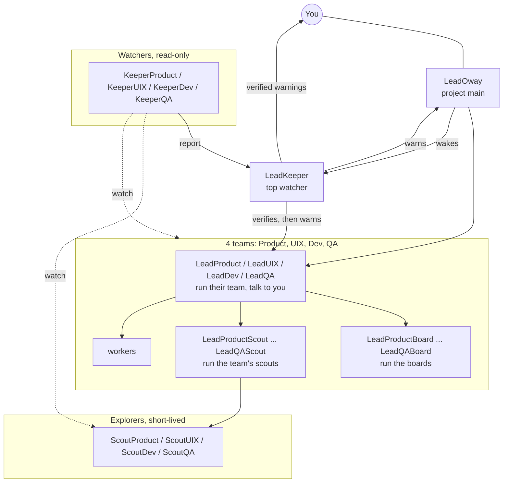
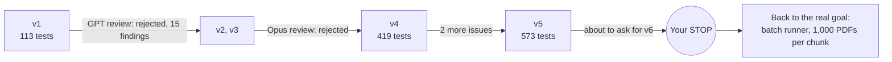

# Teams and roles
Created: 2026-11-15T12:30:00Z · Last edited: 2026-11-15T15:40:00Z

Who is who in **Oway**: the teams, the leads, the keepers, the scouts, and who talks to you. Names put the role first, then the team: LeadQA, KeeperQA, ScoutQA. The glossary is in the [Oway README](README.md#glossary).

## The whole tree

**Two fixed rules.** Only leads talk to you (LeadOway and the four team leads); for any other agent, you go to it yourself. Which agent runs on which AI model is decided later, per agent. No brand names inside technical names.

**Who decides what** (from CGSpec's collaboration contract). You decide goals, taste and the choices with real consequences; the agents do everything else and are responsible for following the method. You never need to learn the method.

| Area | You | The agents alone | The agents must ask you |
| --- | --- | --- | --- |
| Product | Goals, who it is for, scope | Turn your words into intent, users, flows; find gaps | Goals that conflict, scope that grows |
| Design | Taste, references | Proposals, variants, checks | Locking a design |
| Technical | Nothing by default | Choices inside the rules, with a board when it matters | Anything irreversible, money, secrets, data or auth changes |
| Work | Approving each gate | Planning, building, testing, fixing | Going over budget or off the main goal |
| Release | Your OK to go to production | Preparing the release and the rollback | Every production release |

**How a lead contacts you** comes from the **capabilities** given at setup. Example today: two leads can message you on WhatsApp (through Baileys). The tools for this setup will probably be **pi** and **Antigravity**, so it is easy to customize. Later: we define in detail how each lead contacts you.

## Above the teams

| Role | What it does | Old name |
| --- | --- | --- |
| **LeadOway** | The project main. Takes your goal, plans, routes the work, decides or asks you. Does little work itself and does not talk much with you. Cuts the work into milestones and slices once scope and design are fixed | Lead, oway-lead |
| **LeadKeeper** | The top watcher. Woken by LeadOway. Receives what the team keepers see, **verifies it is a real problem**, and is the **only keeper that talks to a lead** (the team lead concerned, or LeadOway), and always to you too: one bad judgment that spreads can bring the whole project down, so LeadKeeper checks before it speaks. Opens an issue on the Oway GitHub repo when a case should improve the method | LeadKeeper, oway-keeper |

LeadOway is the guide: it keeps the full overview and lets the teams work. That is why the agents must run side by side, with LeadOway next to them (Antigravity, the DeepSeek harness, or T3 Code with chats that talk to each other). It costs more tokens, but focused agents waste little.

**LeadOway's own team.** LeadOway only orchestrates and talks to you; it never checks work itself. Its team: **OwayHelpers** (setup only: interview you, record your profile and rules, set the keeper watcher and quota tracking), **LeadOwayBoard** (its advisors for hard cross-team choices), **LeadOwayScout** (research that no single team owns), and **KeeperOway**, the sentinel that watches LeadOway itself (on goal, not looping, not doing a team's job) and reports to LeadKeeper like any KeeperX.

## In every team (Product, UIX, Dev, QA)

| Role | Example | What it does |
| --- | --- | --- |
| Lead | LeadQA | Runs the team. Only the leads talk to you |
| Board lead | LeadQABoard | Runs a board: asks the question, supervises the members, writes the summary, gives it to its team lead. Never gives an opinion itself |
| Workers | QATester1, QATester2... | Do the work of the team |
| Advisor |  | A hat, not an agent: a sub-lead can also advise its lead, and a lead may have one dedicated advisor |

Same shape for the two helpers of every lead: **LeadXBoard** runs the team's boards (LeadQABoard for LeadQA), and **LeadXScout** runs the team's scouts (LeadQAScout for LeadQA). Both supervise, summarise, and give the result to their team lead.

**What each team is for.** Product (was Product Owner): brainstorms with you and writes the scope, the v1; uses a "grill me" skill. UIX: design and user experience, only if there is a UI; you talk to it directly; uses the UI style packs. Dev (was Work): builds the slices and runs the proof loop while building, item by item, until every item passes. QA: comes in when a slice or milestone is built: checks code quality and fit with the overall architecture, does the final review, owns those checkers and the road to production.

**The Platform is not a team.** It is the shared setup all projects use (see [Example setup](example-setup.md)).

**The QA team (only QA has sub-leads for now)**

| Sub-lead | Its workers | Its job |
| --- | --- | --- |
| LeadQATester | QATester1, 2... | Final review of a built slice or milestone: re-runs the proof, probes edge cases, never reads the builder's summary |
| LeadQADelivery | QADelivery1, 2... | Does git, CI/CD, versioning, releases, docs, and owns the index script. Security scanning is a skill of its workers |
| LeadQAArchitect | QAArchitect1, 2... | Checks code quality and fit with the overall architecture at the end of a slice or milestone, and chooses and keeps those checkers (Semgrep, ast-grep...). Does not design |

LeadQATester and LeadQAArchitect also advise LeadQA. LeadQADelivery works both ways with LeadQA.

**Line between Dev and QA.** Dev changes the product. QA never touches the product: it owns the checks and the road to production.

| Task | Who |
| --- | --- |
| Design the architecture | Dev |
| Review it against the code rules | QA architect |
| Write the code and the small tests used while building (TDD) | Dev |
| Draft the proof matrix, write the verifiers and the tests that prove each check | DevProof (a separate Dev agent, never a builder) |
| Run the proof loop item by item while building | Dev builders, with `oway submit`; the script decides |
| Final review of the built slice or milestone | QA tester |
| Check code quality and fit with the architecture | QA architect |
| Choose and set up the checkers | QA architect |
| CI/CD, versioning, releases, docs, security scan | QA delivery |
| Fix a bug QA found | Dev |

**Who writes the indexes.** A script rebuilds them on every push; LeadQADelivery owns the script; KeeperQA checks them. See [Rules](rules.md).

**QA or keeper?** QA **does and judges**; a keeper **only looks and warns**.

|  | QA team | Keepers (KeeperX + LeadKeeper) |
| --- | --- | --- |
| Question it answers | Is the work right? | Is the work going well? |
| Looks at | The product: proofs, tests, checkers, releases | The agents: on goal, looping, stuck, pace, proofs real, docs up to date |
| Acts? | Yes: writes tests, runs the verifiers, does Git and releases (LeadQADelivery) | Never: read-only, sends a finding |
| Git | LeadQADelivery does it: branches, CI, versions, releases | The KeeperX of the team that owns the work checks it: local copy behind, a pull that broke something. Checked before each slice and on a timer |
| Who hears it | LeadOway, then you at the gate | The lead of the team concerned, and you (verified first by LeadKeeper) |

So when the doc says "the keeper" without a name, it means the KeeperX of the team doing that work (KeeperDev for Dev's work), with LeadKeeper verifying before anyone is warned.

**The Dev team.** One line with QA: **Dev builds and proves each item; QA judges the finished slice.** A fixed core in every project, plus builders picked to fit the project.

| Role | Core or picked | Its job |
| --- | --- | --- |
| LeadDev | Core | Drafts the architecture (reviewed by a board), splits each slice into tasks, writes its Git plan (base, branch or worktree, which files each builder owns), starts and assigns the builders, decides when one is stuck, tells LeadOway "ready for QA". Writes no product code |
| LeadDevBoard | Core | Runs the architecture boards (stack, data store, auth, hosting...): members on different models, one log per round, a summary to LeadDev |
| LeadDevScout | Core | Runs the scouts that read official docs and libraries before anyone builds, search open-source code to reuse, or map the code of a project being taken over |
| DevProof | Core | Drafts the proof matrix once the goal is clear (on a strong model), then writes the verifiers and the tests that prove each check, before the builders start. Never builds; the builders cannot edit its files (name still open) |
| DevOps | Core | Builds the product's environments, infrastructure and database migrations. The CI pipelines, versions and releases stay with LeadQADelivery |
| DevBackend | Picked | API, data model, business logic |
| DevFrontend | Picked | Connects the real screens from UIX (tokens, locked design version) to the backend |
| DevData | Picked | Data extraction, parsing, pipelines (for example PDF extraction) |
| DevAI | Picked | Prompts, model calls, agent logic |
| DevMobile | Picked | Mobile app |

The OwayHelpers pick the builders at setup from this list; LeadDev can add one later if a slice needs it, and a small slice may use only one. Each builder works in its own worktree, only in the files it owns: small tests while building (TDD), then `oway submit` for each item of the matrix. The tests that prove each check are written first by DevProof, from the frozen matrix; the builders make them pass, and the slice stays in Dev until every item is PASS. Example, data extraction: DevData builds the extractor; DevProof builds the test set (real sample documents with the expected output) and the accuracy check (for example with DeepEval); QA then judges the finished slice. A builder never writes its own proof, never edits the matrix, the verifiers or the checkers, and never merges.

**The UIX team**

| Role | Its job |
| --- | --- |
| LeadUIX | Talks with you about the design, walks the 8 layers (see [Design](design.md)), locks each layer with you, hands the locked design to LeadDev |
| LeadUIXBoard | Runs the boards that compare 2 or 3 directions, and the critique round before a screen is locked |
| LeadUIXScout | Runs the scouts that find references, style packs and design systems that pass the check |
| UIX1, UIX2... | Build the grey prototypes, the variations, the token sheet, then the real frontend screens with mocked data (layers 5 to 7) |

The critique score that locks a screen comes from someone outside UIX: a QA tester with the rubric. From layer 5, UIX workers build in the real frontend; Dev then connects the backend behind the same interfaces.

## The full communication

Three rules hold everything together:

1. **Messages are not memory.** Anything that matters is written in a file (slice, issue, ADR, ledger line); a message only points to it.
2. **Across teams, only leads talk.** A worker, scout or board member talks only to its own lead.
3. **One short line + a link, 200 characters at most.** Every message between agents, and every message an agent starts to the owner, says what and where, never a long text. Only when the owner is talking with an agent may it explain a little more. See [Rules](rules.md#very-concise-the-oway-way-of-talking).

| From | To | When | How |
| --- | --- | --- | --- |
| You | LeadOway or any team lead | Any time | Chat or your channel (WhatsApp...). You can also open any agent yourself |
| LeadOway | You | At a gate, or when a choice is yours | One short message: what is ready, where the proof is |
| Team lead | You | During its phase (Product scope, UIX design, Dev architecture, QA release) | Its channel, set by capabilities |
| LeadOway | A team lead | Handing over work | The slice file + its GitHub issue, then one line |
| Team lead | LeadOway | Done, stuck, or needs a decision | One line + link ("s012 ready for QA", "s012 BLOCKED: reason") |
| Team lead | Another team lead | Handoff or a question in the other's field | One line + link. Examples: LeadUIX to LeadDev (locked design in design/versions/vN); LeadDev to LeadQA (pull request ready); LeadQA to LeadDev (item FAIL, comment on the issue) |
| Team lead | Its board lead, scout lead, workers | Starting a job | A task file; the result comes back as a file |
| Worker | Its lead | Done, stuck, BLOCKED | `oway submit`, or one line + reason |
| KeeperX | LeadKeeper | A finding | The finding format (Rules, keeper rules) |
| LeadKeeper | The lead concerned, and you | A verified finding | `[KEEPER]` line to the lead; a short message to you |
| LeadKeeper | LeadOway | A finding about the whole project, or the regular report | Report file + one line |
| LeadKeeper | The Oway repo | A case that should improve the method | A GitHub issue |

Who may message you, and on which channel, is set in Step 0 (capabilities). Every message an agent sends you is also written in INBOX.md, secrets removed.

**Agents created on the fly.** The roles above are the fixed base. A project can also need its own specialist agents, for example data extraction agents in a data project. Oway gives a recipe to create one: start from the role card template, pick skills from a known skill stack (Addy Osmani's or another good one), and add it to the project's index.

## Where agents remember

Agents are not fixed: each one is a fresh session that remembers nothing on its own. So the memory lives in files in Git, never inside an agent.

| What the agent needs | Where it lives |
| --- | --- |
| Who I am | Its role card (job, skills, limits) |
| What to do now | The slice file and its checks |
| What happened and why | The ledger (one line per decision or event, from CGSpec) and the ADRs |
| Where we stopped | The checkpoint file, plus a handoff note when a lead's context gets full |

A lead (LeadOway, LeadDev...) lives longer, but it also restarts from the checkpoint and the ledger. Workers, scouts and board members start fresh for each job.

**How it grows.** The agents do not learn; the method does. When something goes wrong or works well, it becomes a change to a role card, a rule or a check: LeadKeeper opens an issue on the Oway repo, and CGSpec's habit applies (every incident becomes a new rule). Because the memory is in Git, you can read and review it, and it survives a change of AI model.

## The keepers (watchers)

A keeper is **read-only**. It watches, it never touches the work, and it never stops anything itself. It is what the paper "Sentinel Agents for Secure and Trustworthy Agentic AI" (Gosmar and Dahl, 2025) calls a sentinel: watch the agents, detect bad behaviour, alert the one who decides.

| Keeper | Watches | Reports to |
| --- | --- | --- |
| KeeperProduct | the Product team | LeadKeeper |
| KeeperUIX | the UIX team | LeadKeeper |
| KeeperDev | the Dev team | LeadKeeper (also its advisor) |
| KeeperQA | the QA team | LeadKeeper (also its advisor) |

**Only LeadKeeper talks to a lead**. A team keeper never warns its team directly: it reports to LeadKeeper, who verifies, then warns the lead concerned and you. The lead decides and acts.

**A keeper does not run for ever**. A KeeperX is awake only while its team works. Two ways to do it, first one first: (1) the team lead tells LeadKeeper when the team starts and when it is done, and LeadKeeper wakes and sleeps the KeeperX; (2) later, the KeeperX wakes by itself when its team is up and sleeps when the team is no longer running (a hook or watcher on the Platform). way (1) first, way (2) later, set up by LeadOway at the start.

**What each keeper checks**. Keepers are split by team, not by job: one KeeperX per team. Each KeeperX runs two checks for its own team: the goal check (is the team still on the main goal, or drifting, looping, stuck) and the proof check (is every claimed result backed by a proof that replays). LeadKeeper verifies, warns, and writes the full report at the interval you set during setup. A keeper only warns; every verified warning goes to the lead and to you.

What a keeper looks for: a worker stuck or seeming to fake its tests; docs or the index drifting from the real state; the local copy behind the repo or a pull that broke something; a push attempt to a protected branch; a loop that burns tokens; the main goal not moving. The exact rules (stop rule, stay on the main goal) are in Rules.

**Real case: why keepers matter.** In a PDF extraction project, the main agent and the infra team looped for 4 days on Postgres trigger scripts (A12) that block updates and deletes of certified rows. The real goal, classifying 47,536 PDFs, was paused. Only the owner's manual STOP ended it. A keeper would have seen the loop at round 3, and LeadKeeper would have warned the lead and you.

## The scouts (explorers)

A scout is a **short-lived explorer or researcher**. One precise zone each, a capped number at once, never reused. Each carries its own skills, so the agent that starts it does not need to know them; that also keeps every agent's context small. Examples: ScoutDev searches for open-source code that fits what we want, or explores the code of a project we take over; ScoutQA and ScoutUIX do the same in their field; ScoutProduct researches a product question. Many agents is not a problem: specialists matter more.

**Each team has a scout lead**: LeadProductScout, LeadUIXScout, LeadDevScout, LeadQAScout. It starts its team's scouts, supervises them, and gives the results to its team lead. There is no scout lead above the teams. If a team needs research in another field, its lead asks the other team's lead. Example: LeadUIX needs code research, it asks LeadDev, whose LeadDevScout runs it. The team keeper watches its own scouts.

## Board (was Council, then task force)

A group of agents on different AI models, set up for one question. Only LeadProduct, LeadUIX, LeadDev and LeadQA can start one (a capability). The team's board lead (LeadQABoard for LeadQA) runs it, supervises it, writes the summary and gives it to its team lead. A board has a **type** in its file header (council, research, prototype...), instead of separate kinds of groups. Each member is a separate agent on its own AI model, and each opinion comes from a separate run, logged with its model name; one agent writing all the opinions itself is a known fake. How it is used in planning: see [How work flows](how-work-flows.md).

| Board lead | Runs boards for | Gives the summary to |
| --- | --- | --- |
| LeadProductBoard | LeadProduct | LeadProduct |
| LeadUIXBoard | LeadUIX | LeadUIX |
| LeadDevBoard | LeadDev | LeadDev |
| LeadQABoard | LeadQA | LeadQA |

Its lead is LeadXBoard.

## When you are a team of people

Draft: nothing changes for the agents. Oway only adds who the humans are.

- **One Platform per team of people**, not per person. Everyone shares the same infra, AI accounts and Oway files. A person working alone is just a team of one.
- **Each project has one Owner**: the person who approves the goal, money, secrets and gates. The project's leads contact only that person.
- **Other people join as contributors.** They can talk directly to LeadProduct (ideas, scope) and to LeadUIX (design), like you do today. They cannot pass a gate.
- **Who is who is set at setup**, the same way as capabilities: each person has a role per project (Owner or contributor) and their own channel (WhatsApp, e-mail).
- **The index records who decided what**, so everyone sees the same state of the project.
