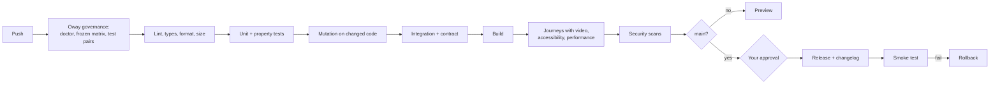

# Versioning, docs and Git
Created: 2026-11-15T12:30:00Z · Last edited: 2026-11-15T12:30:00Z

Git is where the truth lives, so its management is part of the method, not an extra.

## The code is the truth

The code and its tests are the source of truth for how things work. Agents do not write docs that only explain the code; they drift. The only docs Oway keeps say **what and why**: the spines, the proof matrix, decision records (ADRs), the glossary, and a thin map (the index, rebuilt by a script). If a doc and the code disagree, the code wins and the keeper flags the doc.

## Two places, one map

The repo holds the content (markdown files, reviewed through pull requests). GitHub holds the live work. A GitHub Action pushes milestone and slice files to GitHub on every push, and the index reads the state back.

| Oway | GitHub |
| --- | --- |
| Milestone | Milestone |
| Slice | Issue, and its pull request |
| Check | A checkbox in the issue, proven by a CI check |
| Your approval | Your pull request review "Approve" |
| Version | Release, and its changelog |

The file headers fill themselves: created and updated come from Git, approved comes from GitHub, state changes only through set steps. An agent cannot write a wrong date or a fake approval.

## Approvals and accounts

- An approval is a GitHub action from your own account. Agents work through a bot (a GitHub App), so they cannot approve as you.
- `main` is protected (also `dev` and `staging` if used): no direct push, a pull request linked to an issue, your review, all checks green.
- On GitHub's free plan for private repos, branch protection is not available; then CGSpec's fallback applies (ADR-006): squash-merge only, a CI check that flags any commit on main without a pull request, and a local pre-push hook.

## Git for each slice

Before the first code edit, the slice has a Git plan: the base revision, its own branch or worktree, which checks it covers, and which files each worker owns. Parallel workers each have their own worktree and edit only their own files. Commits follow: failing test, then implementation, then passing test.

## What agents never do

Force-push, rewrite history, `git reset --hard`, force-delete a branch, or merge a pull request. They give you the exact command instead (a CGSpec gate enforces it, after a real incident). Opening a pull request never means permission to merge. Every report ends with "Decisions I made for you".

## Versioning

- **The product:** Semantic Versioning. Each slice records its impact (patch, minor, major); a release check refuses a version number that is too small. Each release has a changelog, waits for your approval, gets a smoke test right after deploy, and has a rollback plan written before it ships.
- **The design:** one folder per version in `design/versions/vN/` (see [Design](design.md)).
- **Oway itself:** the project records which Oway version it uses in `_oway/config.json`; upgrading Oway is a planned change that re-runs the checks.

## The pipeline on every push

The governance step runs first and cannot be skipped. The keeper watches Git too: a local copy behind the shared repo, or a pull that broke something, is a finding.
